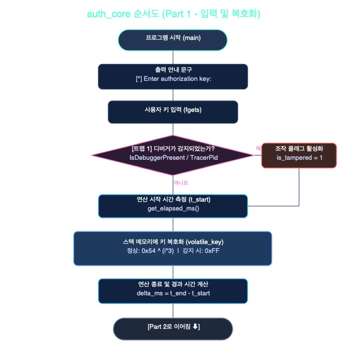
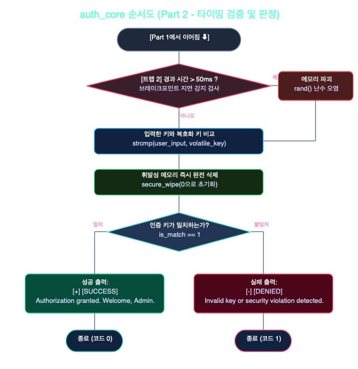

# 🛡️ Reversing Project: Anti-Debugging Challenges

이 저장소는 리버스 엔지니어링 및 안티디버깅 기법을 실습하기 위해 제작된 크랙미(Crackme) 문제 모음입니다.

---

## 📂 수록된 챌린지 목록

| 챌린지 이름 | 주요 기법 | 지원 플랫폼 | 난이도 |
| :--- | :--- | :--- | :--- |
| **1. [dungeon_chest](dungeon_chest.c)** | `sysctl` / `TracerPid` 기본 디버거 감지 + XOR 문자열 검증 | macOS / Linux | ★☆☆☆☆ |
| **2. [auth_core](auth_core.c)** | **휘발성 메모리 복호화 + 50ms 타이밍 트랩 + 디버거 감지** | Windows / Linux / macOS | ★★☆☆☆ |

---

## 📌 Challenge 1: Dungeon Chest (던전의 보물상자)
* **파일**: `dungeon_chest.c`, `solve.py`
* **설명**: 텍스트 RPG 컨셉의 입문용 문제. 디버거가 감지되면 상자가 잠기며 도망치고, 정적 분석을 통해 올바른 패스워드를 찾아내는 챌린지입니다.
* **풀이 도구**: `python3 solve.py`

---

## 📌 Challenge 2: Auth Core (Enterprise Secure Access)
* **파일**: `auth_core.c`
* **핵심 컨셉**: "패스워드는 런타임에 찰나의 순간 동안만 복호화된 후 즉시 삭제된다."

### 🛡️ 적용된 보안 기법
1. **디버거 정적 탐지 (`check_debugger`)**:
   - Windows: `IsDebuggerPresent()` API
   - macOS: `sysctl`을 통한 `p_flag & P_TRACED` 검사
   - Linux: `/proc/self/status`의 `TracerPid` 검사
   - 감지 시 즉시 종료하지 않고, `is_tampered = 1`을 몰래 활성화하여 가짜 쓰레기 키를 생성하도록 유도합니다.
2. **타이밍 트랩 (`delta_ms > 50.0ms`)**:
   - 복호화 연산 전후로 고정밀 타이머(`clock_gettime`, `QueryPerformanceCounter`)를 측정합니다.
   - 분석가가 브레이크포인트를 걸고 멈추는 순간 지연 시간(50ms)을 초과하여 메모리가 `rand()` 난수로 즉시 오염됩니다.
3. **휘발성 메모리 즉시 파괴 (`secure_wipe`)**:
   - 키 검증이 끝나는 즉시 메모리 버퍼를 0으로 밀어버려, 함수 종료 후 메모리 덤프를 방지합니다.

---

## 📊 Auth Core 동작 순서도

순서도는 상반부와 하반부 2개의 이미지로 나뉘어 있습니다:

### Part 1: 입력 및 복호화 단계


### Part 2: 타이밍 검증 및 판정 단계


---

## 🛠️ 컴파일 및 실행 방법

### macOS / Linux
```bash
# 전체 빌드
make

# 개별 빌드
make dungeon_chest
make auth_core
```

### Windows (MSVC / MinGW)
```cmd
# MSVC
cl /O2 /Fe:auth_core.exe auth_core.c

# MinGW (GCC)
gcc -O2 -o auth_core.exe auth_core.c
```

---

## 💡 Auth Core 공략 힌트 (Reversing Walkthrough)
1. 디버거(GDB/x64dbg/LLDB)에서 `check_debugger()`의 반환값(`RAX`/`EAX`)을 `0`으로 조작하여 트랩 1을 우회합니다.
2. `delta_ms > 50.0` 분기 조건을 패치(`NOP`)하거나, 복호화 직후 한 번만 하드웨어 브레이크포인트로 스택 버퍼(`volatile_key`)를 덤프합니다.
3. 획득한 올바른 키를 일반 터미널 실행 시 입력하면 `[+] [SUCCESS]`를 획득할 수 있습니다.
